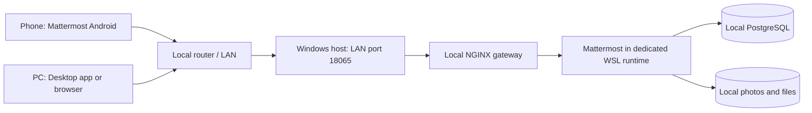

# BartaLAN — বার্তাল্যান

**Local chat, photos, and files when the internet is unavailable.** BartaLAN is a Windows-friendly deployment kit for a self-hosted Mattermost Team Edition server, with a local PostgreSQL database. It uses the existing Mattermost web, Desktop, and Android clients; it is not a fork of those apps.

**Idea conceived: August 8, 2024.** Al Muzahid Seyam conceived this project in response to Bangladesh's 2024 internet shutdowns, during Sheikh Hasina's government. This is the author's idea date; repository and implementation timestamps reflect when the work was actually done.

[বাংলা ব্যবহারবিধি](docs/বাংলা-নির্দেশিকা.md) · [Operations and recovery](docs/operations.md) · [Network limits](docs/network.md)

[Pilot verification and remaining device checks](docs/validation.md)

## What works without the internet

- Local username/password login, channels, group conversations, and direct messages.
- Bengali text, photos, and files up to 25 MiB per upload.
- Locally stored messages and attachments, persistent across server restarts.
- Starting cached server images without checking an internet registry.

**Devices must still have a network route to the server.** Connecting two phones to unrelated home Wi-Fi networks does not connect those networks to each other. The first deployment targets one LAN. Across homes, the ISP must provide and preserve the required routing; across ISPs, local interconnection must also remain available.



## Windows 11 setup

Requirements: working WSL 2, an x86-64 PC, spare memory for the server, disk space for shared files, and internet access **during initial downloads**. The supplied install script uses a dedicated `BartaLAN` WSL distribution stored at `D:\BartaLAN\runtime`; it preserves other distributions. Docker data and named volumes live in that distribution's Linux filesystem on D:.

Open PowerShell in this repository:

The default host port is **18065**. To use another free port, pass `-AppPort` to `Initialize.ps1`; any explicit `-SiteUrl` must use that same port. Windows initialization rejects ports reserved by Windows/Hyper-V.

```powershell
powershell -NoProfile -ExecutionPolicy Bypass -File .\scripts\Install-Windows.ps1
powershell -NoProfile -ExecutionPolicy Bypass -File .\scripts\Initialize.ps1
powershell -NoProfile -ExecutionPolicy Bypass -File .\scripts\Start.ps1 -DownloadImages
powershell -NoProfile -ExecutionPolicy Bypass -File .\scripts\Trust-LocalCertificate.ps1
powershell -NoProfile -ExecutionPolicy Bypass -File .\scripts\Bootstrap.ps1
```

First installation can take several minutes. After bootstrap and local CA trust setup, sign in at `https://localhost:18065` with the credentials in **`.secrets/admin.json`**. Change the administrator password after sign-in, and update that private file if you want to rerun the integration test. Local placeholder addresses ending in `@bartalan.invalid` do not receive email. The server has email delivery disabled. See [certificate setup](docs/https.md) for other devices.

If Docker is installed but WSL cannot download images while Windows can, run `scripts/Fetch-Images.ps1` from Windows instead of `Start.ps1 -DownloadImages`, then run `Start.ps1`. It uses the pinned official images through a checksum-verified Windows download tool and checks the imported filesystem and execution settings against the verified archive. Immutable local image IDs are recorded in `.env` because Docker may convert legacy archive manifests during import. The source image digests remain in `.env.example` and the private `.runtime/image-lock.json`.

Use `Start-BartaLAN.cmd`, `Stop-BartaLAN.cmd`, and `Status-BartaLAN.cmd` for daily operation. Starting normally never downloads images. Restart the server after each Windows reboot; automatic Windows startup is not configured. A stopped or sleeping PC cannot deliver messages.

The Windows start script keeps one hidden WSL helper running while serving chat, because systemd services alone do not keep WSL alive. The stop script closes only its own recorded helper after stopping the services. This keeps the server available when the terminal window is closed.

### Connect phones and other computers

1. Reserve the server PC's LAN address in your router's DHCP settings.
2. Set `.env` to use that address, for example `SITE_URL=https://192.168.1.20:18065` and `BIND_ADDRESS=0.0.0.0`. This example address is not discovered automatically.
3. Run `scripts/Start.ps1` again to apply changes.
4. Open **PowerShell as Administrator**, then run the following with your actual address and subnet:

```powershell
.\scripts\Enable-Lan.ps1 -LanAddress 192.168.1.20 -Subnet 192.168.1.0/24
```

The script forwards this LAN address and the host's loopback address, and adds one firewall rule limited to that subnet, including when Windows labels the connection Public. The explicit loopback entry also supports hosts where WSL's automatic localhost forwarding is unavailable. It does not open your router, disable the firewall, or expose the database. Rerun it after a WSL address change. See [network troubleshooting](docs/network.md).

Install this server's public CA certificate on each device, then open `https://192.168.1.20:18065` in a browser. In Mattermost Desktop/Android, use that complete URL. Install the clients while internet access is available. **A stock Android app may reject a user-installed CA even when the browser trusts it. Native Android/Desktop compatibility is not yet verified.** Use a trusted browser for the pilot and see [HTTPS setup](docs/https.md). Do not bypass certificate warnings.

Users can choose **Create an account**, enter an email/username and a strong password, then join the public **BartaLAN** team. Passwords require at least 12 characters, including upper/lowercase, a number and a symbol. Email ownership is not verified in this offline setup. Anyone who can reach the service can register; the default Windows firewall still restricts access to the chosen LAN subnet. The administrator can alternatively create an account locally:

```powershell
.\scripts\Add-User.ps1 -Username friend
```

The script prompts privately for a password and adds the account to the BartaLAN team. Existing users can be managed by the administrator in Mattermost. New accounts receive ordinary user privileges.

## Offline behavior and boundaries

- Mattermost and PostgreSQL share an **internal Docker network** with no external route. A small NGINX gateway connects that network to the published LAN port; only the gateway also joins an ingress network. It proxies to the local chat service and has no internet upstream. External email, mobile push notifications, link previews, diagnostics, notices, GIF search, and plugins are disabled. Updates require deliberate image downloads while internet access is available.
- Mobile background push depends on Google/Apple infrastructure and is unavailable offline. Keep the app open for live updates; reconnect to fetch messages stored while disconnected.
- Voice/video, internet relays, public tunnels, and cross-ISP routing are outside this pilot's scope.
- The gateway uses HTTPS (TLS 1.2/1.3) with a private local CA. Only its HTTPS port is published; old HTTP bookmarks redirect to HTTPS. The CA signing key is never mounted in the gateway. Signup/login attempts are rate limited. Windows portproxy can make multiple users share one apparent source address, so limits may affect several users together. A shared ISP deployment still needs deliberate routing, DNS, access controls, power backup, and an operator.
- Do not assume self-signed certificates will work in the stock mobile app. Public certificates can be provisioned beforehand with DNS validation, but renewal needs planning; an offline private CA needs client trust/compatibility testing.
- Mattermost server storage is not end-to-end encrypted: administrators can access stored content. Do not describe this as an anonymous or censorship-proof network.
- Images and the app must be downloaded before an outage. Retaining power, a router, and a route to the server is essential. Windows/WSL is the pilot host; sustained community operation should use a maintained Linux server.

## Verify

With Node.js 22 or newer and the private bootstrap credentials:

```powershell
node .\tests\smoke.mjs
# Optional: also stop/start this project's services and verify persistence.
node .\tests\smoke.mjs --restart
```

This tests HTTPS with certificate validation, open signup and lobby membership, password rules, two independent accounts, Bengali live messaging over secure WebSockets, direct messages, authenticated photo/file upload/download, content hashes, and offline configuration. It creates temporary accounts and a test team, deactivates/archives them afterwards, and removes its posts. Test audit records and uploaded file blobs can remain; use a test server for repeated runs. Local results are ignored by Git. `python3 tests/security.py --rate-limit` separately checks trust/hostname rejection and real signup throttling on a disposable test instance.

From a Linux/Docker terminal, run `python3 tests/isolation.py` to verify that Mattermost and PostgreSQL have only an internal network, no external default route, and no directly published ports. The gateway is the only ingress point.

For the actual outage drill, disconnect only the router's WAN/uplink while keeping the router and server powered. Use two physical devices to test login, messages, attachments, and reconnect. Server isolation tests do not replace this physical test.

## Project files

| File | Purpose |
| --- | --- |
| `compose.yaml` | Pinned Mattermost/PostgreSQL/NGINX services and isolated application network |
| `scripts/` | Windows setup, account management, start/stop, LAN access, backup |
| `tests/smoke.mjs` | Real-server integration test |
| `docs/` | Bengali instructions, topology, backup and recovery |

`.env`, credentials, generated certificates/keys, runtime downloads, messages, and backups are excluded from Git. Backups contain private chat data and secrets, including the local CA key; keep them private.

## Sources and license

- [Mattermost air-gapped configuration](https://docs.mattermost.com/deployment-guide/air-gapped-operations/disable-phone-home-features)
- [Mattermost hardware/software requirements](https://docs.mattermost.com/deployment-guide/software-hardware-requirements)
- [Mattermost mobile troubleshooting](https://docs.mattermost.com/deployment-guide/mobile/mobile-troubleshooting)
- [Docker internal networks](https://docs.docker.com/reference/compose-file/networks/#internal)
- [Microsoft WSL LAN networking](https://learn.microsoft.com/en-us/windows/wsl/networking#accessing-a-wsl-2-distribution-from-your-local-area-network-lan)

BartaLAN's original scripts and documentation are MIT licensed. Upstream software retains its own licenses and trademarks. Review the selected Mattermost edition's terms and limits before a community deployment. Contributions should include a relevant real-server test and preserve the network limitations above.
